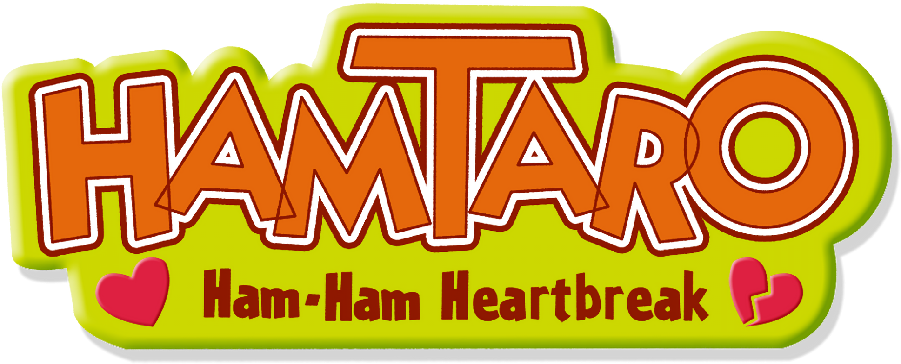

<p align="center">
  
</p>

# Hamtaro: Ham-Ham Heartbreak — Native PC Port

A native Windows port of **Hamtaro: Ham-Ham Heartbreak** for Game Boy Advance,
based on the [game's decompilation](https://github.com/josealmon/hamtaro-heartbreak).
The game logic runs as compiled x64 code, with SDL3 handling the desktop window,
audio and controllers.

**You need your own European ROM to play.** The ROM and extracted gameplay
resources are not included.

## Features

- **Keyboard and gamepad support**, with remappable buttons, optional WASD
  movement, controller selection and adjustable stick deadzone.
- **Resizable window and fullscreen**, preserving the original aspect ratio.
  Nearest-neighbor rendering keeps pixels sharp; integer scaling is optional.
- **Volume and mute controls**, plus optional pausing when switching applications.
- **Compatible save files:** import an original 32 KiB `.sav` and continue playing.
  Saves and settings stay in your profile when you replace the executable.
- **Pause and resume with Escape**, with access to settings while playing.
- **Cable Link over LAN:** exchange Ham-Jam dances between two PCs using
  **Create connection** and **Join by IP**.

Single-player routes have been tested through the ending, all 21 reconciliations
and all 86 Ham-Chats.
See [tested scope](docs/architecture.md#tested-scope) for coverage details.

## Getting started

1. Extract the Windows ZIP into a folder.
2. Run **`Hamtaro - Ham-Ham Heartbreak.exe`**.
3. Select your compatible `.gba` file in the launcher.
4. Choose **Play**.

Requires **Windows 10 or 11, 64-bit**. No BIOS file is needed.
The launcher copies the validated ROM into your local profile; it does
not modify the file you selected.

### Supported ROM

| Property | Required version |
| --- | --- |
| Game | Hamtaro: Ham-Ham Heartbreak |
| Region | Europe |
| Game code | `AH3P` |
| Revision | `0` |
| Size | 16 MiB (16,777,216 bytes) |
| Languages | English, French, German, Spanish and Italian |

The launcher checks the ROM's identity and full SHA-256 hash:

```text
401968322b3245381da64dab35bdaacb3f82a404425c584867f00c45e469ffd8
```

Other regions, revisions and modified ROMs are not supported. The game's language
is selected in its own title menu, independently of the launcher language.

## Default controls

| Action | Keyboard | Gamepad |
| --- | --- | --- |
| Move | Arrow keys or WASD | D-pad or left stick |
| A | Z | South face button |
| B | X | East face button |
| L / R | Q / E | Left / right shoulder |
| Start | Enter | Start |
| Select | Right Shift | Back / View |
| Open pause menu | Escape | Right-stick click |
| Resume | Escape, or Resume in the menu | Resume in the menu |
| Toggle fullscreen | F11 | — |

Change game bindings in **Controls**. Assigning W, A, S or D to an action disables
the WASD movement shortcut until those keys are free. Resetting controls restores
the default bindings and enables WASD again.

## Cable Link over LAN

1. Start the game on both PCs, then press **Escape** and open **Cable Link**.
2. On one PC, choose **Create connection**. On the other, enter the displayed
   IPv4 address for your shared Wi-Fi or Ethernet network and choose **Join by IP**.
3. Once both show **Connected**, resume and open **Ham-Jam** from the title menu.
   Choose a song and dance, open **Trade**, and select **Send Ham-Jam** or
   **Get Ham-Jam**. Confirm the delivery and choose a save slot in the game.

Both PCs need this port with a compatible Cable Link protocol and their own ROM.
TCP port **24816** must be reachable on the local network; allow the application
through Windows Firewall on your private network if prompted. No Internet server,
account or router port forwarding is required. Disconnect from the Cable Link
panel when finished. This protocol connects copies of this port, not GBA hardware
or emulator link implementations.

## Saves and settings

The launcher stores your ROM, settings and save in `%USERPROFILE%\.hamtaro-native`.
Use **Import save** or **Open save folder** on Home to manage your save. The game
uses its original save system and keeps one previous save backup. Emulator save
states are not supported.

For a separate profile, launch the application with `--data-dir "PATH_TO_PROFILE"`.

## Building from source

Install Visual Studio Build Tools with the **Desktop development with C++**
workload, including the Windows SDK and the bundled CMake tools (3.25 or newer).
Run these commands from the repository root in Developer PowerShell.

```powershell
cmake -S . -B build -A x64
cmake --build build --config Release
```

CMake fetches SDL3 and Dear ImGui automatically. The executable is written to
`build/Release/Hamtaro - Ham-Ham Heartbreak.exe`. To run the tests, use
`ctest --test-dir build -C Release --output-on-failure`.

## Documentation and credits

- [Architecture and tested scope](docs/architecture.md)
- [Testing and packaging](docs/testing.md)
- [Hamtaro: Ham-Ham Heartbreak decompilation](https://github.com/josealmon/hamtaro-heartbreak)
- [Third-party notices](NOTICE.md)

This is an unofficial fan project, with no affiliation with Nintendo or the
Hamtaro rights holders. Code and third-party licensing details are in `NOTICE.md`.
